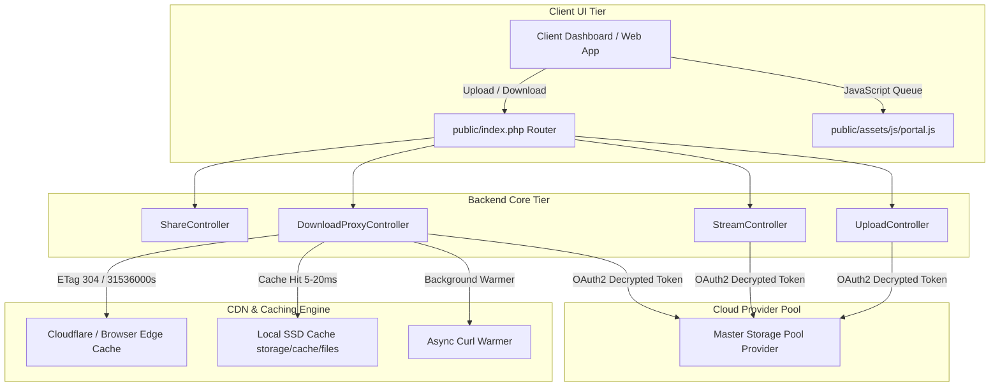
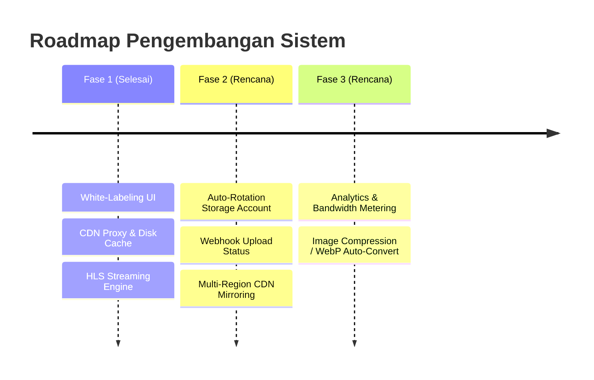

# 📘 RPD — Rencana Pelaksanaan & Pengembangan Detail (Technical Architecture & Development Roadmap)

## 🎯 1. Informasi Proyek & Arsitektur Utama
- **Nama Proyek**: Drive Portal Client (White-Label Storage Gateway)
- **Repository / Branch**: `google-driver-cloud` (`clien-cloud`)
- **Tujuan Sistem**: Menghubungkan & menggabungkan *multiple* akun penyimpanan menjadi **Master Storage Pool** yang dialokasikan secara aman per *client user* dengan domain kustom **White-Label**.
- **Prinsip Utama**: 100% White-Label (Pengguna tidak pernah melihat nama provider, domain, URL, atau logo pihak ketiga di UI maupun *CDN response*).

---

## 🏗️ 2. Arsitektur Komponen & Alur Kerja (Component Architecture)



---

## 📋 3. Rekap Implementasi & Fitur Terpasang (Current State)

### A. System White-Labeling (100% Client Masking)
- **Status Bar & Upload Widget**: Semua teks status seperti `Menyimpan ke Google Drive...` diganti menjadi `Menyimpan ke Cloud Storage...`.
- **Error Handling**: Pesan kesalahan sistem telah diganti menjadi istilah umum (*Cloud Storage*).
- **Admin Dashboard & Manual**: Input ID root folder dan panduan pengguna bebas dari merk pihak ketiga.

### B. High-Performance CDN Delivery Engine
- **Direct Raw/CDN Route**: Endpoint `/share?id=...&raw=1` dan `/download?id=...` menyajikan media secara langsung.
- **Edge Caching**:
  - `ETag 304 Not Modified` (0ms payload untuk repeat visitor).
  - `Cache-Control: public, max-age=31536000, immutable`
  - `Cloudflare-CDN-Cache-Control: max-age=31536000`
- **Local SSD Cache**:
  - Penyimpanan berkas di `storage/cache/files/` (Limit 1GB, TTL 7 Hari).
  - **LRU Eviction**: Pembersihan otomatis berkas terlama saat disk mendekati batas 80%.
- **Cross-Origin Embedding**: Header `Access-Control-Allow-Origin: *` aktif untuk kompatibilitas landing page eksternal.

### C. HLS Video Streaming & 4MB Chunking
- **Adaptive Bitrate Streaming**: Berkas video di-stream melalui playlist HLS `.m3u8` dan segmen `/stream/{id}/segment/{n}`.
- **Instant Video Playback**: Potongan *range request* 4MB untuk respon playback startup <30ms.
- **Hotlink Protection**: Validasi `HTTP_REFERER` terhadap `allowed_domains` milik user.

---

## 🔮 4. Roadmap & Panduan Pengembangan Kedepan (Future Expansion Guide)

Dokumen ini disusun agar mudah dikembangkan untuk fase selanjutnya:



### 🚀 Rekomendasi Area Pengembangan Selanjutnya:
1. **Auto-Rotation Storage Provider**:
   - Menambahkan algoritma distribusi otomatis saat mengunggah berkas besar ke akun penyimpanan yang memiliki sisa kapasitas paling lapang.
2. **WebP Auto-Convert pada CDN**:
   - Mengintegrasikan konversi gambar otomatis (*on-the-fly*) ke format `.webp` / `.avif` pada `DownloadProxyController` untuk menghemat bandwidth hingga 60%.
3. **Bandwidth Analytics & Rate Metering**:
   - Mencatat total bandwidth CDN yang dikonsumsi per pengguna untuk analisis pemakaian kuota bulanan.
4. **Multi-Bucket Fallback (Failover)**:
   - Menambahkan mekanisme *failover* ke S3/R2 jika token provider utama mengalami gangguan.

---

## 🗂️ 5. Struktur Berkas Kunci (Key File Reference)

| Path Berkas | Fungsi Utama | Catatan Pengembangan |
| :--- | :--- | :--- |
| `public/assets/js/portal.js` | UI Frontend & Upload Queue | Mengontrol widget upload, chunking client-side, dan render UI. |
| `src/Controllers/DownloadProxyController.php` | Proxy CDN & Disk Cache Engine | Mengelola header CDN, CORS, disk cache, dan LRU eviction. |
| `src/Controllers/StreamController.php` | Video HLS Player & Streamer | Mengelola generator HLS playlist, segmen video, dan hotlink protection. |
| `src/Controllers/ShareController.php` | Public Share & Raw Router | Memproses routing tampilan publik vs direct raw CDN. |
| `src/Views/admin.php` | Admin Management Dashboard | Tempat alokasi storage pool dan pendaftaran user client. |

---

## 🛠️ 6. Cara Menjalankan & Verifikasi Kode

```bash
# 1. Jalankan Server Lokal
php -S 0.0.0.0:4545 -t public/

# 2. Verifikasi Sintaks PHP & JS
php -l src/Controllers/DownloadProxyController.php
node --check public/assets/js/portal.js

# 3. Sinkronisasi Git
git status
git add .
git commit -m "docs: add comprehensive RPD roadmap for future development"
git push origin clien-cloud
```
