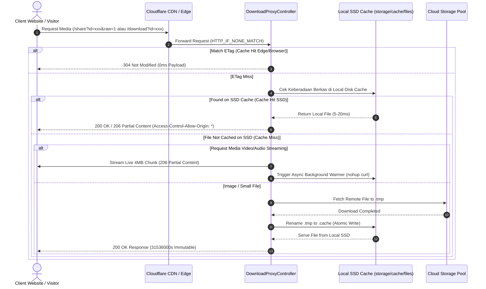
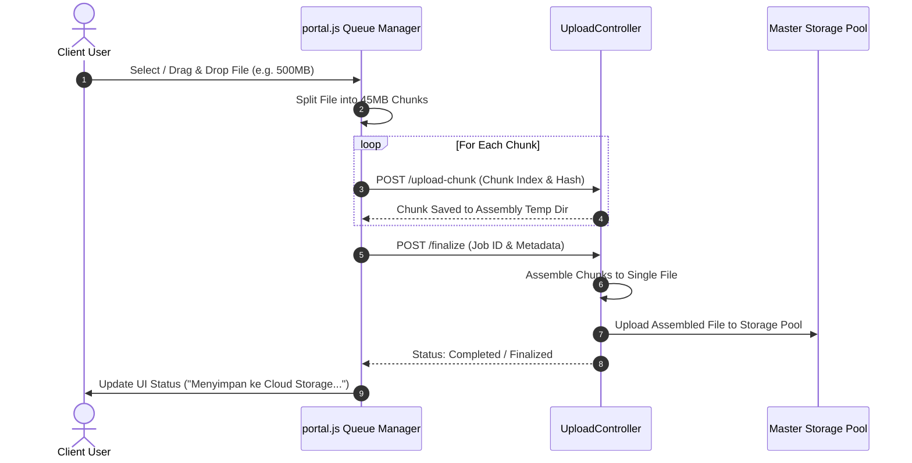
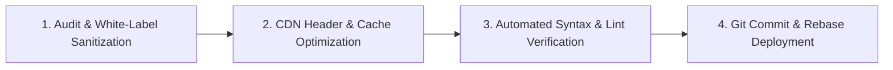
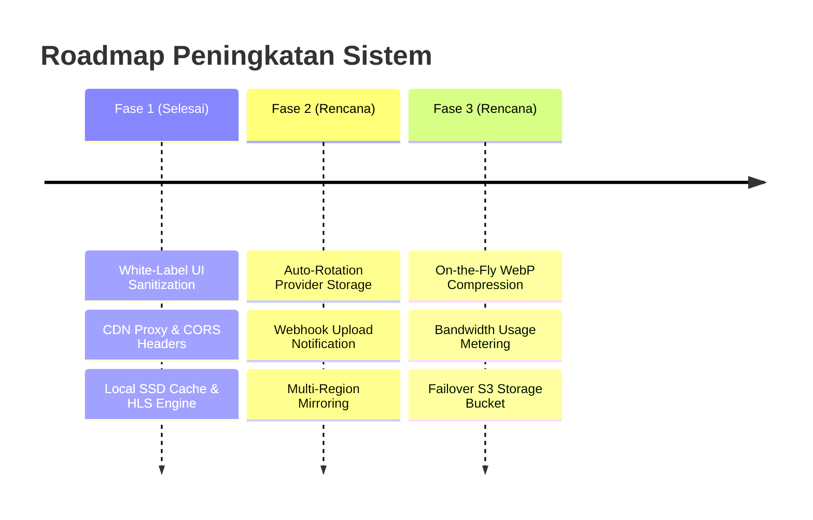

# 📘 RPD — Rencana Pelaksanaan & Pengembangan Detail (AI-Agent & Developer Specification)

> [!IMPORTANT]
> **PETUNJUK KHUSUS UNTUK AI AGENT & DEVELOPER SEANTERO SIBER (AI-CONTEXT DIRECTIVES)**
> - **Aturan Utama White-Label**: JANGAN PERNAH menampilkan nama provider backend (seperti *Google Drive*) pada antarmuka pengguna (UI), notifikasi toast, error response, atau header HTTP client. Semua teks UI **WAJIB** menggunakan istilah umum (*Cloud Storage* / *Penyimpanan*).
> - **Aturan CDN Header**: Setiap perubahan pada controller penyaji media ([DownloadProxyController.php](file:///c:/Users/ADMIN/Desktop/framework/google-drive/cliend/src/Controllers/DownloadProxyController.php)) **WAJIB** mempertahankan header CORS (`Access-Control-Allow-Origin: *`), `ETag`, dan `Cache-Control` immutable agar media dapat di-embed secara lancar di *landing page* eksternal.
> - **Integritas Storage Pooling**: Jangan mengubah logika dekripsi token OAuth2 AES-256-GCM pada model backend agar alokasi kuota user ke *Master Storage Pool* tetap aman.

---

## 🎯 1. Ringkasan Sistem & Arsitektur Utama
- **Nama Aplikasi**: Drive Portal Client (White-Label Cloud Gateway)
- **Repositori & Branch**: `google-driver-cloud` (`clien-cloud`)
- **Fungsi Utama**: Menghubungkan & menggabungkan *multiple* akun penyimpanan cloud menjadi **Satu Master Storage Pool**. Pengguna dialokasikan kuota secara independen dengan tampilan *white-label* penuh.

---

## 📐 2. Bagan Arsitektur & Diagram Alur Kerja (System Flowcharts)

### Bagan A: Arsitektur Komponen & Data Flow
```mermaid
flowchart TD
    subgraph Frontend Tier (Client Browser)
        UI[Client Dashboard / Web App]
        JS[public/assets/js/portal.js]
    end

    subgraph Backend Routing Tier
        R[public/index.php Router]
        AUTH[AuthController]
        SEC[SecurityModel]
    end

    subgraph CDN & Proxy Tier
        PROXY[DownloadProxyController]
        STREAM[StreamController]
        SHARE[ShareController]
    end

    subgraph Storage & Cache Engine
        ETAG[ETag 304 Validator]
        CACHE_DISK[Local SSD Cache: storage/cache/files]
        LRU[LRU Eviction Engine]
        WARM[Background Async Warmer]
    end

    subgraph Storage Pool Provider
        POOL[Master Cloud Storage Pool]
    end

    UI -->|AJAX / Fetch| R
    JS -->|45MB Chunk Upload| R
    R --> SEC --> AUTH
    R --> SHARE --> PROXY
    R --> STREAM --> PROXY

    PROXY --> ETAG
    ETAG -->|304 Not Modified| UI
    PROXY --> CACHE_DISK
    CACHE_DISK -->|Cache Hit 5-20ms| UI
    PROXY --> WARM --> POOL
    PROXY -->|Cache Miss Stream| POOL
```

---

### Bagan B: Alur Resolusi Caching CDN (CDN Request Sequence)


---

### Bagan C: Alur Pengunggahan Berkas Chunk (Upload Sequence)


---

## 📜 3. Rekap Kronologi Pengerjaan (Step-by-Step Execution Log)



### Tahap 1: Pembersihan Teks White-Label
- **Deskripsi**: Menghapus seluruh klausa/teks yang menyebutkan "Google Drive" di sisi antarmuka pengguna (*client-facing UI*).
- **Perubahan Berkas**:
  - `public/assets/js/portal.js`: Memperbarui status widget upload, sub-teks progress, error callback, notifikasi toast, dan panduan onboarding.
  - `src/Views/admin.php`: Memperbarui placeholder input `root_folder_id`.
  - `docs/PANDUAN_PENGGUNA_PORTAL_CLIENT.md`: Mengadaptasi teks manual pengguna ke standar 100% White-Label.

### Tahap 2: Review & Optimasi Controller CDN Proxy
- **Deskripsi**: Memastikan media yang disajikan dapat di-embed di website eksternal tanpa terhalang isu CORS atau port.
- **Perubahan Berkas**:
  - `src/Controllers/DownloadProxyController.php`:
    - Menambahkan header CORS (`Access-Control-Allow-Origin: *` & `Access-Control-Allow-Methods: GET, OPTIONS`).
    - Mengatur header caching `Cache-Control: public, max-age=31536000, immutable` dan `Cloudflare-CDN-Cache-Control: max-age=31536000`.
    - Memperbarui skema URL `warmUrl` agar dinamis mengikuti `$_SERVER['HTTP_HOST']`.

### Tahap 3: Verifikasi Sintaks & Keamanan
- **Pengujian CLI**:
  - `php -l src/Controllers/DownloadProxyController.php` ➔ **Lolos (0 Syntax Error)**.
  - `php -l src/Views/admin.php` ➔ **Lolos (0 Syntax Error)**.
  - `node --check public/assets/js/portal.js` ➔ **Lolos (0 Syntax Error)**.

### Tahap 4: Deployment & Kontrol Versi Git
- Eksekusi `git add .`, `git commit`, `git pull --rebase origin clien-cloud`, dan `git push origin clien-cloud` hingga status repositori `working tree clean`.

### Tahap 5: Penyaringan Berkas Duplikat & Pengunggahan Massal Terpisah
- **Deskripsi**: Ketika mengunggah banyak gambar/berkas sekaligus (misal 10 file) di mana sebagian berkas sudah ada di folder:
  - Berkas baru (non-duplikat) disaring dan **langsung diunggah tanpa penundaan**.
  - Berkas duplikat diisolasi dan menampilkan modal opsi **Ganti (Replace)** atau **Simpan Kedua Berkas (Keep Both dengan auto-rename unik)**.
  - Membatalkan modal duplikat tidak akan membatalkan berkas baru yang sedang diunggah.
- **Perubahan Berkas**:
  - `public/assets/js/portal.js`: Menambahkan logika `processSelectedFiles()` untuk menyaring `cleanFiles` dan `duplicateFiles` secara independen.

---

## 🔮 4. Peta Jalan & Panduan Pengembangan Kedepan (Future AI Roadmap)



### 🚀 Area Prioritas untuk AI Agent / Developer Selanjutnya:
1. **Auto-Rotation Storage Account Provider**:
   - *Tujuan*: Mengotomatiskan pemilihan akun penyedia saat mengunggah berkas besar ke akun yang memiliki sisa kuota terbesar.
   - *Lokasi Kode*: [PortalModel.php](file:///c:/Users/ADMIN/Desktop/framework/google-drive/cliend/src/Models/PortalModel.php).
2. **On-the-Fly WebP / AVIF Image Compression**:
   - *Tujuan*: Mengompres gambar secara otomatis saat diakses via CDN (`/share?id=...&raw=1`) untuk menghemat konsumsi bandwidth hingga 60%.
   - *Lokasi Kode*: [DownloadProxyController.php](file:///c:/Users/ADMIN/Desktop/framework/google-drive/cliend/src/Controllers/DownloadProxyController.php).
3. **Analytics & Bandwidth Metering**:
   - *Tujuan*: Mencatat byte yang disajikan melalui CDN ke dalam tabel database per pengguna.

---

## 📁 5. Tabel Referensi Berkas Kunci (Key File Registry)

| Berkas | Peran Utama | Catatan Kunci AI Agent |
| :--- | :--- | :--- |
| [public/assets/js/portal.js](file:///c:/Users/ADMIN/Desktop/framework/google-drive/cliend/public/assets/js/portal.js) | Frontend Queue & Widget UI | Jangan ubah objek antrean `gdriveQueue` (digunakan secara internal). Teks UI harus tetap *white-label*. |
| [src/Controllers/DownloadProxyController.php](file:///c:/Users/ADMIN/Desktop/framework/google-drive/cliend/src/Controllers/DownloadProxyController.php) | CDN Engine & Disk Cache | Mengatur header `ETag`, `304`, `CORS`, `LRU Eviction` (cap 1GB, 7 hari). |
| [src/Controllers/StreamController.php](file:///c:/Users/ADMIN/Desktop/framework/google-drive/cliend/src/Controllers/StreamController.php) | HLS Streamer & Embed | Mengelola playlist `.m3u8`, segmen video, dan proteksi `HTTP_REFERER`. |
| [src/Controllers/ShareController.php](file:///c:/Users/ADMIN/Desktop/framework/google-drive/cliend/src/Controllers/ShareController.php) | Public Share Router | Memilih antara tampilan HTML share atau alur *direct raw stream*. |
| [src/Views/admin.php](file:///c:/Users/ADMIN/Desktop/framework/google-drive/cliend/src/Views/admin.php) | Master Admin Dashboard | Panel pengelolaan kuota user, IP Whitelist, dan pembentukan Root Folder ID. |
| [docs/PANDUAN_PENGGUNA_PORTAL_CLIENT.md](file:///c:/Users/ADMIN/Desktop/framework/google-drive/cliend/docs/PANDUAN_PENGGUNA_PORTAL_CLIENT.md) | User Manual Document | Dokumen panduan penggunaan pengguna client. |

---

## 🛠️ 6. Command Verifikasi & Sintaks Developer

```bash
# 1. Jalankan Server Development Lokal
php -S 0.0.0.0:4545 -t public/

# 2. Verifikasi Sintaks PHP & JavaScript
php -l src/Controllers/DownloadProxyController.php
php -l src/Views/admin.php
node --check public/assets/js/portal.js

# 3. Sinkronisasi Git Repository
git status
git add .
git commit -m "docs: update comprehensive RPD specification for AI agent and future roadmap"
git push origin clien-cloud
```
